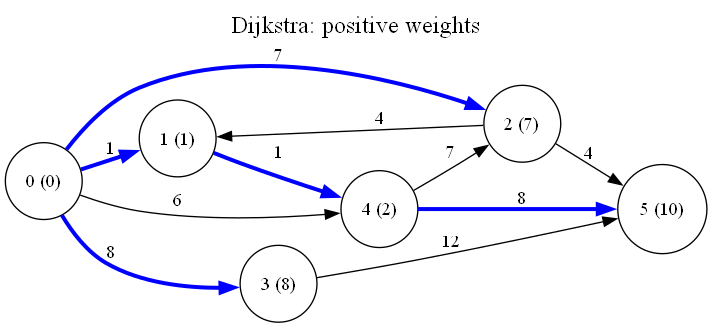
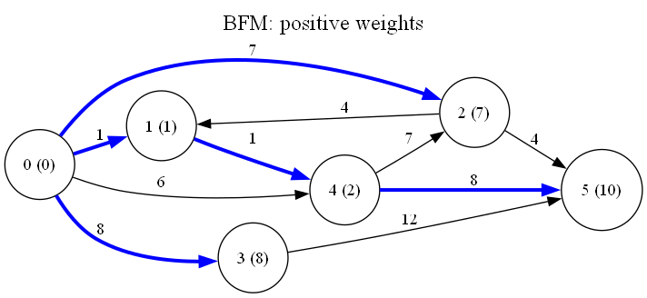
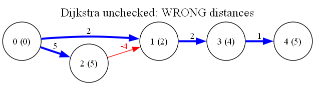
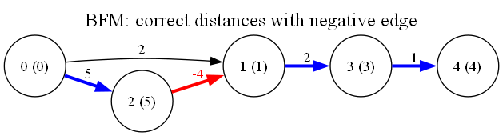
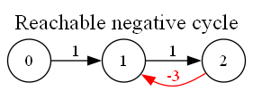

# Лабораторная работа № 3. Кратчайшие пути

**Цель:** реализовать алгоритмы Дейкстры и Беллмана - Форда - Мура для поиска кратчайших путей из заданной вершины ориентированного взвешенного графа и сравнить результаты их работы.

## Алгоритмы

**Алгоритм Дейкстры** последовательно выбирает необработанную вершину с наименьшим текущим расстоянием от источника и уточняет расстояния до её соседей (релаксация). Для выбора вершины используется `std::priority_queue`. После обработки расстояние до вершины считается окончательным. Алгоритм гарантированно корректен при **неотрицательных весах** дуг; сложность с очередью с приоритетом $O((V+E)\log V)$.

**Алгоритм Беллмана - Форда - Мура** до $V-1$ раз проходит по всем дугам, уточняя расстояния. Он допускает отрицательные веса, но при достижимом отрицательном цикле конечные кратчайшие расстояния для части вершин не существуют. Дополнительный проход позволяет обнаружить такой цикл. Сложность $O(VE)$.

Граф представлен **списком смежности** (`vector<vector<Edge>>`). Для каждой вершины хранятся расстояние `dist` и предшественник `prev`, по которому восстанавливается путь. Источник во всех опытах - вершина **0**.

## Результаты

**1. Граф без отрицательных дуг.** Оба алгоритма получили одинаковые кратчайшие расстояния:

| Вершина | 0 | 1 | 2 | 3 | 4 | 5 |
|:--|--:|--:|--:|--:|--:|--:|
| Расстояние | 0 | 1 | 7 | 8 | 2 | 10 |

<p align="center">
  
  
</p>

*Рис. 1–2. Кратчайшие пути по Дейкстре и Беллману - Форду - Муру.*

**2. Отрицательная дуга без отрицательного цикла.** В графе есть дуга $2\to1$ веса $-4$. Корректная реализация Дейкстры отказывается работать с таким графом. Если намеренно отключить проверку весов, алгоритм фиксирует вершину 1 слишком рано и получает **неверное** расстояние до вершины 4: **5** вместо **4**. Беллман - Форд - Мур находит правильный путь $0\to2\to1\to3\to4$ длины $5-4+2+1=4$.

<p align="center">
  
  
</p>

*Рис. 3–4. Ошибочный результат Дейкстры без проверки весов и корректный результат Беллмана - Форда - Мура.*

**3. Отрицательный цикл.** В графе присутствует достижимый цикл $1\to2\to1$ суммарного веса $1+(-3)=-2$. Беллман - Форд - Мур обнаруживает его и сообщает, что для части вершин кратчайшее расстояние не определено.

<p align="center"></p>

*Рис. 5. Граф с отрицательным циклом.*

```cpp
#include <iostream>
#include <fstream>
#include <vector>
#include <queue>
#include <functional>
#include <limits>
#include <algorithm>
#include <string>

#include <cstdlib>
#include <filesystem>
#include <fstream>

using namespace std;

using Vertex = int;        // Номер вершины ориентированного графа
using Cost = long long;    // Вес дуги и длина пути
const Vertex None = -1;
const Cost Inf = numeric_limits<Cost>::max() / 4;

struct Edge {
    Vertex to;
    Cost cost;
};

using Adj = vector<vector<Edge>>; // Список смежности
using Dist = vector<Cost>;        // Кратчайшие расстояния
using Prev = vector<Vertex>;      // Предки в кратчайших путях

// Общая реализация Дейкстры. Параметр checkNegative отключается
// ТОЛЬКО в учебном эксперименте, чтобы показать ошибку алгоритма.
bool DijkstraImpl(const Adj& adj, Vertex source, Dist& dist, Prev& prev,
                  bool checkNegative) {
    const int n = static_cast<int>(adj.size());
    if (source < 0 || source >= n) return false;

    if (checkNegative) {
        for (const auto& edges : adj)
            for (const Edge& edge : edges)
                if (edge.cost < 0) return false;
    }

    dist.assign(n, Inf);
    prev.assign(n, None);
    vector<bool> used(n, false);

    // В начале очереди - вершина с минимальным текущим расстоянием.
    using Item = pair<Cost, Vertex>;
    priority_queue<Item, vector<Item>, greater<Item>> pq;
    dist[source] = 0;
    pq.push({0, source});

    while (!pq.empty()) {
        Vertex v = pq.top().second;
        pq.pop();
        if (used[v]) continue;
        used[v] = true; // Расстояние окончательно зафиксировано.

        for (const Edge& edge : adj[v]) {
            // Именно это свойство неверно при наличии отрицательных дуг:
            // путь к уже обработанной вершине может стать короче.
            if (used[edge.to]) continue;
            Cost candidate = dist[v] + edge.cost;
            if (candidate < dist[edge.to]) {
                dist[edge.to] = candidate;
                prev[edge.to] = v;
                pq.push({candidate, edge.to});
            }
        }
    }
    return true;
}

// Корректное применение алгоритма Дейкстры: веса >= 0.
bool Dijkstra(const Adj& adj, Vertex source, Dist& dist, Prev& prev) {
    return DijkstraImpl(adj, source, dist, prev, true);
}

// Демонстрация: намеренно запускаем Дейкстру без проверки весов.
// При отрицательных дугах этот результат НЕ гарантированно верен.
bool DijkstraUnchecked(const Adj& adj, Vertex source, Dist& dist, Prev& prev) {
    return DijkstraImpl(adj, source, dist, prev, false);
}

// Беллман - Форд - Мур. Работает с отрицательными дугами;
// возвращает false при отрицательном цикле, достижимом из source.
bool BFM(const Adj& adj, Vertex source, Dist& dist, Prev& prev) {
    const int n = static_cast<int>(adj.size());
    if (source < 0 || source >= n) return false;

    dist.assign(n, Inf);
    prev.assign(n, None);
    dist[source] = 0;

    for (int iteration = 0; iteration < n - 1; ++iteration) {
        bool changed = false;
        for (Vertex from = 0; from < n; ++from) {
            if (dist[from] == Inf) continue;
            for (const Edge& edge : adj[from]) {
                Cost candidate = dist[from] + edge.cost;
                if (candidate < dist[edge.to]) {
                    dist[edge.to] = candidate;
                    prev[edge.to] = from;
                    changed = true;
                }
            }
        }
        if (!changed) break; // Досрочное завершение.
    }

    // Если после n-1 проходов расстояние ещё уменьшается,
    // существует достижимый отрицательный цикл.
    for (Vertex from = 0; from < n; ++from) {
        if (dist[from] == Inf) continue;
        for (const Edge& edge : adj[from]) {
            if (dist[from] + edge.cost < dist[edge.to]) return false;
        }
    }
    return true;
}

vector<Vertex> RestorePath(Vertex source, Vertex target, const Prev& prev) {
    vector<Vertex> path;
    for (Vertex v = target; v != None; v = prev[v]) {
        path.push_back(v);
        if (v == source) break;
        if (path.size() > prev.size()) return {}; // Защита от цикла.
    }
    if (path.empty() || path.back() != source) return {};
    reverse(path.begin(), path.end());
    return path;
}

void PrintPaths(ostream& os, Vertex source, const Dist& dist, const Prev& prev) {
    for (Vertex v = 0; v < static_cast<int>(dist.size()); ++v) {
        os << "vertex " << v << ": ";
        if (dist[v] == Inf) {
            os << "unreachable\n";
            continue;
        }
        os << "distance = " << dist[v] << ", path = ";
        vector<Vertex> path = RestorePath(source, v, prev);
        for (size_t i = 0; i < path.size(); ++i) {
            if (i) os << " -> ";
            os << path[i];
        }
        os << '\n';
    }
}

// DOT: вершины подписаны расстояниями, дуги кратчайших путей выделены
// синим, отрицательные дуги - красным. Общая дуга - красная и толстая.
void PrintDot(ostream& os, const Adj& adj, const Dist& dist,
              const Prev& prev, const string& title) {
    os << "digraph G {\n";
    os << "  graph [label=\"" << title << "\", labelloc=t, fontsize=18];\n";
    os << "  rankdir=LR;\n";
    os << "  node [shape=circle];\n";

    for (Vertex v = 0; v < static_cast<int>(adj.size()); ++v) {
        os << "  " << v << " [label=\"" << v;
        if (v < static_cast<int>(dist.size())) {
            if (dist[v] == Inf) os << " (INF)";
            else os << " (" << dist[v] << ")";
        }
        os << "\"];\n";
    }

    for (Vertex from = 0; from < static_cast<int>(adj.size()); ++from) {
        for (const Edge& edge : adj[from]) {
            const bool inTree = edge.to < static_cast<int>(prev.size())
                                && prev[edge.to] == from;
            os << "  " << from << " -> " << edge.to
               << " [label=\"" << edge.cost << "\"";
            if (edge.cost < 0) os << ", color=red, fontcolor=red";
            else if (inTree) os << ", color=blue";
            if (inTree) os << ", penwidth=3";
            os << "];\n";
        }
    }
    os << "}\n";
}

void SaveDot(const string& filename, const Adj& adj,
             const Dist& dist, const Prev& prev,
             const string& title) {
    {
        ofstream out(filename);
        if (!out) {
            cerr << "Cannot write " << filename << '\n';
            return;
        }

        PrintDot(out, adj, dist, prev, title);
    } 

    string png = filename;
    filesystem::path path(filename);
    path.replace_extension(".png");
    png = path.string();

    string command = "dot -Tpng \"" + filename +
                     "\" -o \"" + png + "\"";

    if (std::system(command.c_str()) != 0) {
        cerr << "Graphviz failed\n";
        return;
    }

    cout << "Saved: " << filename << " and " << png << '\n';
}

int main() {
    const Vertex source = 0;
    Dist dist;
    Prev prev;

    // Случай 1. Исходный граф: все веса неотрицательны.
    const Adj positive = {
        /* 0 -> */ {{1, 1}, {2, 7}, {3, 8}, {4, 6}},
        /* 1 -> */ {{4, 1}},
        /* 2 -> */ {{1, 4}, {5, 4}},
        /* 3 -> */ {{5, 12}},
        /* 4 -> */ {{2, 7}, {5, 8}},
        /* 5 -> */ {}
    };

    cout << "=== CASE 1: NONNEGATIVE WEIGHTS ===\n";
    if (Dijkstra(positive, source, dist, prev)) {
        cout << "Dijkstra:\n";
        PrintPaths(cout, source, dist, prev);
        SaveDot("01_positive_dijkstra.dot", positive, dist, prev, "Dijkstra: positive weights");
    }
    if (BFM(positive, source, dist, prev)) {
        cout << "BFM:\n";
        PrintPaths(cout, source, dist, prev);
        SaveDot("01_positive_bfm.dot", positive, dist, prev, "BFM: positive weights");
    }

    // Случай 2. Отрицательное ребро, но отрицательного цикла НЕТ.
    // Правильный путь до 4: 0 -> 2 -> 1 -> 3 -> 4, длина 4.
    // Непроверенный Дейкстра ошибочно найдёт длину 5.
    const Adj negativeEdge = {
        /* 0 -> */ {{1, 2}, {2, 5}},
        /* 1 -> */ {{3, 2}},
        /* 2 -> */ {{1, -4}},
        /* 3 -> */ {{4, 1}},
        /* 4 -> */ {}
    };

    cout << "\n=== CASE 2: NEGATIVE EDGE, NO NEGATIVE CYCLE ===\n";
    if (!Dijkstra(negativeEdge, source, dist, prev))
        cout << "Dijkstra: rejected (negative edge).\n";

    // Исключительно демонстрационный запуск некорректного алгоритма.
    DijkstraUnchecked(negativeEdge, source, dist, prev);
    cout << "Dijkstra WITHOUT validation (WRONG RESULT):\n";
    PrintPaths(cout, source, dist, prev);
    SaveDot("02_negative_dijkstra_wrong.dot", negativeEdge, dist, prev,
            "Dijkstra unchecked: WRONG distances");

    if (BFM(negativeEdge, source, dist, prev)) {
        cout << "BFM (CORRECT RESULT):\n";
        PrintPaths(cout, source, dist, prev);
        SaveDot("02_negative_bfm_correct.dot", negativeEdge, dist, prev,
                "BFM: correct distances with negative edge");
    }

    // Случай 3. Достижимый отрицательный цикл 1 -> 2 -> 1: 1 + (-3) = -2.
    const Adj negativeCycle = {
        /* 0 -> */ {{1, 1}},
        /* 1 -> */ {{2, 1}},
        /* 2 -> */ {{1, -3}}
    };
    cout << "\n=== CASE 3: NEGATIVE CYCLE ===\n";
    if (!BFM(negativeCycle, source, dist, prev))
        cout << "BFM: reachable negative cycle detected; some shortest distances are undefined.\n";
    SaveDot("03_negative_cycle.dot", negativeCycle, {}, {}, "Reachable negative cycle");

    return 0;
}
```

## Вывод

Оба алгоритма корректно находят кратчайшие пути при неотрицательных весах. Эксперимент показал, почему **Дейкстра не гарантирует правильный результат при отрицательных дугах**: ранее зафиксированное расстояние может уменьшиться. Алгоритм Беллмана - Форда - Мура работает с отрицательными весами и позволяет обнаруживать достижимые отрицательные циклы.
